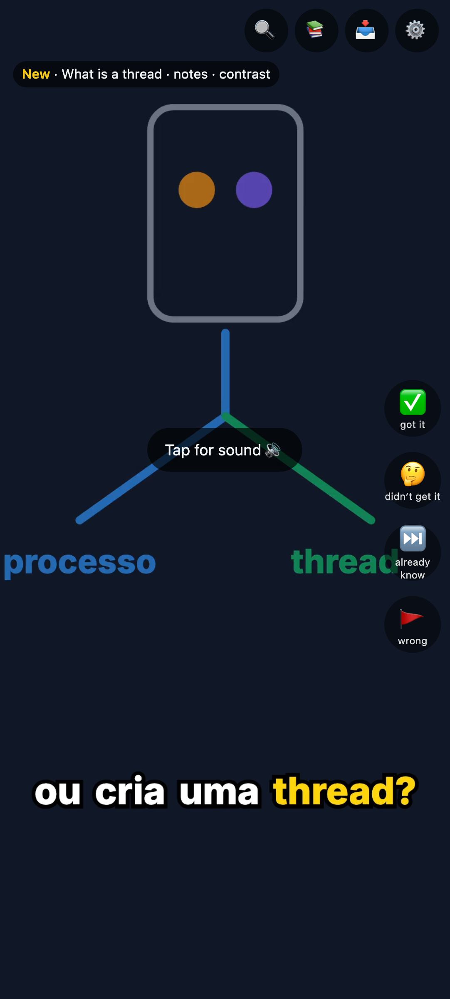

# doomlearn

Turns long reading material (books, articles) into a personal Feed of short narrated explainer Clips, so you study by scrolling instead of reading.



## Why

Many people own books they want to read and never finish. A chapter asks for 40 minutes of focus. A short-video feed holds attention without effort, but it teaches nothing.

doomlearn points that feed at your own books. You keep the scroll and lose the junk: every Clip explains one idea from a book you chose, and the Feed brings each idea back until you know it.

## How it works

1. You add a Source (`.pdf`, `.epub`, `.azw3`, `.md` or `.txt`). doomlearn splits it into Chapters.
2. An agent reads each Chapter and extracts its Concepts: one self-contained idea each, such as "what is a thread".
3. For each Concept, an agent writes a script grounded in its Passage, and a second agent pass checks the script against the Passage. Deterministic checks reject copied runs of words and code read aloud.
4. A local TTS voice narrates the script, a local aligner times each word, and Remotion renders a vertical mp4 of up to 60 s with word-by-word captions.
5. Your phone plays the Feed as an installable PWA, one Clip per screen. Clips are cached, so the Feed plays offline.

The agents are the Claude Code and Codex CLIs, on your own subscription logins. You choose the Provider, the model and the Effort for each stage. doomlearn never calls a paid API and never reads your credentials.

## What the Feed does

- **Spaced Reviews.** ✅ moves a Concept up a 1d, 3d, 7d, 21d, 60d ladder. A Concept you understood enough times is Retired.
- **A new Angle when you are confused.** 🤔 makes a new Clip of the same Concept with a different Angle (example, analogy, mechanism or contrast), instead of replaying the same one.
- **An honest end.** A daily cap on new Clips and no early Reviews. When nothing is due, the Feed says so and stops.
- **Every Clip links to its Passage**, by page range or by Chapter and section. 🚩 flags a bad Clip, and the Inbox lets you fix content and pronunciation.
- **Languages.** Clips in Brazilian Portuguese, English or Spanish. A Clip can be remade in another Language. A per-Language Lexicon fixes how terms are spoken, with a preview from the phone.
- **Control of the Mac.** Run windows, a Worker pause and a stop before a Usage window runs out keep doomlearn off your plan while you work. Every Blocker shows its reason in the ⚙️ screen.

The terms used here (Source, Concept, Clip, Angle, Feed, …) are defined in [GLOSSARY.md](GLOSSARY.md).

## Built by agents

AI agents wrote almost all of this repo, with the maintainer making the decisions. The work follows the [mattpocock/skills](https://github.com/mattpocock/skills) flow: a wayfinder map of open questions, research, a grilling session per decision, a spec, tickets, test-first implementation in parallel worktrees, and a two-axis code review (standards and spec).

The rules that the agents follow live in the repo:

- [AGENTS.md](AGENTS.md): the operating rules for any agent working here.
- [docs/research/v2/](docs/research/v2/README.md): the research behind the v2 design, with the evidence for each choice.
- [docs/CODE_STYLE.md](docs/CODE_STYLE.md): the rules that code review checks.
- Tests run on recorded fixtures for the Claude and Codex CLIs. Before an agent calls a UI change done, it runs an e2e test at phone size and a check on an Android emulator.

## Supported host

macOS on Apple Silicon only: TTS runs on PyTorch (MPS) and alignment on MLX. Tests run on any OS (see [CONTRIBUTING.md](CONTRIBUTING.md)).

## Quickstart

1. Install the prerequisites (Node 24 or later, pnpm, mkcert, Calibre, ZeroTier, Claude Code, and a `python3` of any version). Add `codex` to the cask list if you want stages on Codex. The Xcode Command Line Tools (`xcode-select --install`), which git also needs, include `python3`; `brew install python` works too.

   ```sh
   brew install node pnpm mkcert && brew install --cask calibre zerotier-one claude-code
   ```

2. Sign in to Claude Code once: `claude auth login`.
3. Clone the repo and install its dependencies: `git clone https://github.com/ribeironicolas/doomlearn.git && cd doomlearn && pnpm install`.
4. `pnpm bootstrap`. It installs a repo-local uv with your `python3`, builds the media environments on uv's own Python 3.12 (downloaded once, never a Homebrew or system one), downloads the pinned voice and aligner weights (~7.4 GB with the English and Spanish voice, into `~/.cache/huggingface`) and Remotion's browser. Slow the first time; run it again whenever `pnpm start` says so.
5. `pnpm start`. It first runs `pnpm preflight`, which lists each missing prerequisite with its install hint. It then creates the data folder `~/doomlearn` (or `$DOOMLEARN_HOME`) and serves the Feed at `http://127.0.0.1:8443`, on this Mac only.
6. In a second terminal, in the repo, `pnpm doomlearn add <file>`, e.g. `pnpm doomlearn add ~/Downloads/notes.md`. A relative path is read from the repo root. The first Clip takes several minutes; `pnpm doomlearn status` shows the progress. Open `http://127.0.0.1:8443` to watch it.

**Anyone on your ZeroTier network, and any web page open on your Mac, can reach your Clips.** There is no login: the network is the access control. Keep the ZeroTier network to your own devices and never expose the port to the internet.

## What doomlearn is not

doomlearn is a personal tool: one Learner, one Mac, your own reading material. It does not publish Clips, it is not a hosted service, and it has no paid-API fallback. [.out-of-scope/](.out-of-scope/) says why for each.

## More

- Phone access (ZeroTier and an mkcert certificate), start and stop, logs, the data folder and upgrades: [docs/OPS.md](docs/OPS.md).
- Settings: the ⚙️ screen in the PWA, or `config.json` in the data folder, described key by key in [`config.schema.json`](packages/core/config.schema.json).
- Billing: doomlearn runs `claude -p` and `codex exec` on your own logins, so it spends your subscriptions; an `ANTHROPIC_API_KEY` in its environment bills the API instead ([docs/OPS.md](docs/OPS.md#billing)).
- Security: [SECURITY.md](SECURITY.md).
- Contributing: [CONTRIBUTING.md](CONTRIBUTING.md).
- License: [AGPL-3.0](LICENSE), with an added permission to combine doomlearn with Remotion. Remotion has [its own license](https://www.remotion.dev/license), free for individuals and companies of up to 3 people.
